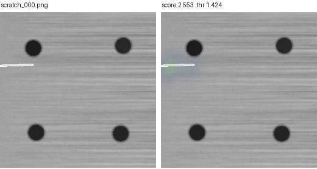
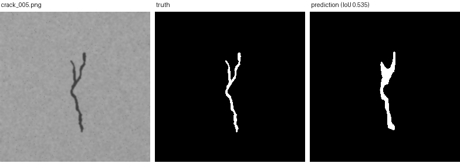
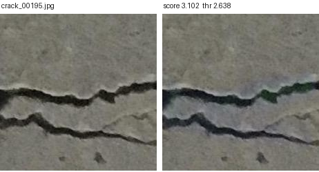

# Visual Defect Inspection

**Tech Boss · trained on good parts only, calibrated to the false-alarm rate you choose.** Two modes for production-line and infrastructure inspection on a CPU:

- **Anomaly mode** (`inspect_anomaly.py`): a memory bank of patch features from good parts (PatchCore-style, frozen ImageNet ResNet-18, no training), a heatmap of how far every patch of a new image is from the nearest good patch, an image score, and a threshold calibrated on held-out good parts at a target false-alarm rate. No defect examples are needed to start; when some exist, they measure what the threshold catches.
- **Segmentation mode** (`inspect_cracks.py`): DeepLabV3 MobileNetV3-Large fine-tuned for crack masks, probability threshold chosen on a validation split, IoU reported on a held-out test split, per-image panels for the worst and best cases.

Both write dashboards that show the misses and false alarms, not only the hits, and `serve.py` is a drag-and-drop page that returns the heatmap and a calibrated verdict.

**Measured on real concrete photographs and on drawn parts.** On 500 real concrete images (CC BY 4.0 dataset, 400 with cracks) the anomaly mode fitted on crack-free photos only reaches image AUROC 0.995 and catches 398 of 400 cracks at a threshold calibrated on held-out crack-free images, with 10 of 100 clean images flagged. Three synthetic product categories and synthetic cracks, drawn with a pixel mask for every defect, give the exact image-level and pixel-level numbers. MVTec AD and similar sets carry non-commercial licences and were not used. See `DATA_SOURCES.md` and [MODEL_CARD.md](MODEL_CARD.md).

## Quick start

Python 3.12 in a virtual environment; `requirements.txt` pins the tested CPU builds of torch and torchvision. The logic tests need only the standard library; the rendering and pipeline tests need numpy and Pillow (torch is never needed by the tests).

```sh
python -m venv .venv
# Activate .venv with the command for your shell.
python -m pip install -r requirements.txt
python -m unittest discover -s tests -v
```

Reproduce the demo in three commands (first run downloads the ResNet-18 and DeepLabV3 checkpoints into the Torch cache):

```sh
python synthetic_parts.py --anomaly artifacts/data --cracks artifacts/cracks --seed 5
python inspect_anomaly.py benchmark --data artifacts/data --output artifacts/anomaly --false-alarm 0.05
python inspect_cracks.py train --data artifacts/cracks --output artifacts/cracks-model --epochs 6
```

Open `artifacts/anomaly/dashboard.html` and `artifacts/cracks-model/dashboard.html`.

## Real photos in the same benchmark

```sh
python import_folders.py --good concrete/Negative --defective concrete/Positive --category concrete --output artifacts/real --train 300 --calibration 100 --test-good 100 --test-defective 400 --defect-name crack
python inspect_anomaly.py --coreset 0.05 benchmark --data artifacts/real --output artifacts/anomaly-real
```

`import_folders.py` turns two folders (good, defective) into the benchmark layout; masks are optional, and without them the pixel AUROC is skipped. The concrete run is in `examples/anomaly-real/`.

## Your parts

```sh
python inspect_anomaly.py fit --good photos/good --output banks/widget
python inspect_anomaly.py calibrate --bank banks/widget --good photos/good-heldout --defective photos/bad --false-alarm 0.05
python inspect_anomaly.py score --bank banks/widget --input photos/new --output out/widget
python serve.py --bank banks/widget              # then open http://127.0.0.1:8766/
python inspect_cracks.py predict --model artifacts/cracks-model/cracks.pt --input photos/walls --output out/cracks
```

- **Fit** needs only good parts photographed the way the line will photograph them (same camera, lighting and framing). Fifty images is a reasonable start; the coreset keeps 10% of the patches so the bank stays a few megabytes.
- **Calibrate** needs a second set of good parts that were not used for the fit. The threshold is the empirical quantile of their scores at `1 - false_alarm`, exactly the recipe of the sensor-anomaly project, so the operator decides how many good parts may be flagged per hundred. Labelled defects are optional and only reported (AUROC, recall at the threshold, the best-F1 threshold for reference); they never move the threshold.
- **Score** writes a JSON verdict per image (`score`, `threshold`, `defect`, `margin`, hottest point) and a side-by-side panel with the heatmap; `--sigma` smooths the heatmap, `--input-size` changes the backbone resolution (224 default; raise it for small defects, as the detector projects in this portfolio also found).
- **Cracks**: `train` expects the layout written by `synthetic_parts.py --cracks` (`train/val/test` folders with `<name>.png` and `<name>_mask.png`, plus `index.json`); `predict` applies the saved threshold and writes masks and panels.

## How it works

| Stage | Module | What it does |
|---|---|---|
| Features | `features.py` | Frozen TorchVision ResNet-18; layer2 and layer3 maps concatenated at stride 8 and locally averaged (3x3), 384-d patches on a 28x28 grid at 224 px. |
| Bank | `anomaly.py` | Greedy k-center coreset on a random projection; nearest-neighbour patch distances in chunks; bilinear upsampling and Gaussian smoothing for the heatmap; quantile calibration; JSON + `.npy` persistence. |
| Metrics | `metrics.py` | Rank-based AUROC with tie handling, threshold statistics, empirical quantile, best-F1 reference, mask IoU/Dice, subsampled pixel AUROC. |
| Cracks | `inspect_cracks.py` | One-logit DeepLabV3 head, weighted BCE for rare crack pixels, flips, best epoch by validation IoU, threshold sweep on validation, test report with per-image IoU and false crack pixels on clean images. |
| Report | `render.py` | Heatmap overlays with the truth outline, score histograms and threshold curves as SVG, galleries. |

Everything except the two backbones is numpy and standard-library Python with unit tests: AUROC on perfect, inverted and tied scores; quantile and threshold statistics; coreset size and uniqueness; an injected anomalous patch raising the score and landing at the right heatmap position; calibration using good scores only; bank round trip; mask metrics; every synthetic defect having a mask that is where the pixels changed; and an end-to-end benchmark on a small synthetic set with a stand-in feature extractor.

## Evidence

`examples/anomaly/` and `examples/cracks/` hold the dashboards, reports, banks' metadata and the panels of the actual local runs described in `DATA_SOURCES.md`; [MODEL_CARD.md](MODEL_CARD.md) gives per-category AUROC, recall at the calibrated threshold, crack IoU, and what was not measured.







## Limitations

- The real run is on concrete texture crops; manufactured parts with specular highlights, perspective and assembly variation were only drawn. The bank is fitted on the client's own good parts and the threshold on a separate set from the same camera, and the calibration set must be as varied as production (on concrete, the 5% target became 10% on rougher test images).
- The greedy coreset scales badly: a few hundred good images per category is the practical limit on a CPU without an approximate nearest-neighbour library.
- Image-level scores are the maximum patch distance, so a single odd patch (a fingerprint, a label edge) flags the part; the heatmap shows why, and masking the regions that are allowed to vary is the usual fix.
- Pixel-level localisation is coarse (stride 8 at 224 px); small defects need a larger `--input-size` or a tiled scan.
- The crack model is trained on synthetic cracks on synthetic concrete; it is a demonstration of the training, thresholding and reporting path, not a crack detector for the field.
- Docker files are written but were not built here (no Docker on the preparation machine). Everything runs on CPU; a GPU would speed the feature extraction but is not required.
